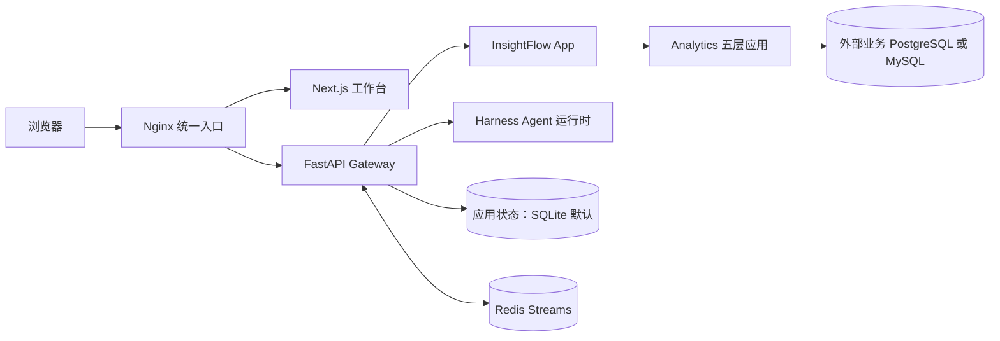

# InsightFlow

[中文](README.md) | [English](README_en.md)

InsightFlow 是我围绕内部业务数据分析设计并实现的 Agent 工作台。项目基于 LangGraph Agent 运行时，把数据目录、服务端授权、证据核验与报告发布串成可追溯的流程，同时保留普通聊天的通用工具循环和 task 子 Agent 能力。

> 2026-10-10 的验收快照记录了提交 `b40ea6b497b6559eb0731cb6f370f53085fbd33d` 的六个 GitHub Actions 工作流成功，以及本机部署检查通过。它只描述该提交当时的结果；范围与证据见[验收快照](docs/acceptance/2026-10-10-ci-final-acceptance.md)。

## 项目亮点

- **把通用运行时接入受控分析产品：** 将 InsightFlow App 与可复用 Harness 分层，在 Analytics 中落实目录、授权、只读查询、证据与报告发布之间的服务端契约。
- **让报告数字能回到证据：** 查询结果绑定当前 run；Data 提交引用证据单元格的数值计划，Gateway 使用 `Decimal` 重新计算，再交由固定 Writer 和零工具 Reviewer 完成发布流程。
- **把两种 Agent 工作方式分开：** 普通聊天保留通用工具循环和可配置扩展；Analytics 使用固定工具集和有界角色调用，降低模型绕过产品授权路径的机会。
- **覆盖完整的工作台操作：** 提供数据源与指标目录、分析阶段轨迹、报告下载、会话、审计历史和定时任务入口。

## 技术栈

| 层 | 技术 |
| --- | --- |
| Web 工作台 | Next.js、React、TypeScript |
| 统一入口 | Nginx 反向代理 |
| Gateway 与产品应用 | Python、FastAPI |
| Agent 运行时 | LangGraph、InsightFlow Harness |
| 查询与存储 | SQLGlot、外部 PostgreSQL/MySQL、应用 SQLite；Redis Streams 用于内部事件桥接 |
| 本地交付 | Docker Compose，或 Make 驱动的本地开发服务 |

## 功能与操作

首次使用者在 `/setup` 创建首位管理员，之后从 `/login` 登录。工作台入口如下：

| 页面 | 用途 |
| --- | --- |
| `/workspace/analysis/new` | 提交经营问题，启动受控分析；页面不提供数据源或指标选择器 |
| `/workspace/chats` | 浏览当前账号可见的会话，可切换活动和归档视图 |
| `/workspace/chats/new` | 开始普通聊天，使用通用 Agent |
| `/workspace/datasources` | 查看已登记数据源；管理员可维护配置与 schema snapshot |
| `/workspace/metrics` | 查看自己拥有或获明确授权的指标；管理员可管理定义和授权 |
| `/workspace/reports` | 查看已发布报告并打开相关会话 |
| `/workspace/history` | 查看当前账号可见的审计历史 |
| `/workspace/scheduled-tasks` | 创建和查看定时任务；后台调度还需启用 `scheduler.enabled` |

## Agent 能力

### 普通聊天

普通聊天由通用 Lead Agent 运行工具循环。启用 `task` 后，Lead 可以把有边界的工作委派给 task 子 Agent；运行时为每项委派分配独立执行身份，并通过队列、并发上限、超时、token budget、取消和结果回执控制生命周期。当前默认容量为同时运行 3 项、排队 64 项，排队等待 300 秒；运维配置可以调整这些值。

以下能力由运维配置，具体可用项取决于部署设置：

| 能力 | 用途 |
| --- | --- |
| MCP | 通过 MCP 接入外部工具；长时任务交由 Gateway 的耐久 task 服务记录状态并支持恢复。 |
| Skills | 发现并加载可复用的任务说明；可按需要搜索和读取具体内容，避免把所有说明一直放进上下文。 |
| Memory 与摘要 | 持久记忆可提取、更新和召回跨会话信息；摘要中间件按阈值压缩较早消息并保留近期上下文。 |
| Sandbox | Local 文件与命令工具使用 Gateway 主机权限，不构成隔离；AIO 是外部 sandbox 服务的客户端，隔离边界由该外部服务决定。InsightFlow 不启动 AIO 服务端。 |
| Plan 与澄清 | 普通聊天可使用计划模式和交互式澄清；内部非交互运行会移除澄清工具。 |

这些能力不会因安装项目而默认全部开启；Local sandbox 与扩展以 Gateway 权限运行，只应加载可信来源。

Gateway 通过 checkpoint 保存运行状态，并可将事件写入应用数据库以便查看历史和恢复运行信息；SSE 将运行与子任务进度推送到工作台，取消请求会进入对应 run 或子任务生命周期。定时任务复用普通 run 路径，必须在 `config.yaml` 启用 `scheduler.enabled`；繁忙时的 occurrence 先持久化为 `queued`，再经租约保护的 `launching` 状态进入运行，等待中的任务不占用运行并发额度。

### 受控 Analytics

Analytics 路径关闭通用 `task` 委派、Skills、Memory 与通用 plan mode。Lead 只使用固定的三个工具：`inspect_business_catalog`、`query_business_data`、`write_analysis_report`。它在同一 run 内调用有界 SQL Analyst 和 Data 角色，再进入固定 Writer 与零工具 Reviewer 发布流程。

服务端先按登录主体读取可见数据目录和指标，再由 SQL Analyst 整理查询；SQLGlot AST 检查和语义授权通过后，Gateway 才签发短期一次性执行计划，并以只读方式执行带行数、字节数、时限和审计约束的查询。原始 SQL 与结果行不会出现在阶段 UI 中。

查询结果登记为当前 run 的 evidence。Data 角色输出引用 evidence 单元格的 `NumericClaimPlan`，domain verifier 在服务端使用 `Decimal` 计算并核对声明。随后固定 Report Writer 生成报告，零工具 Reviewer 执行有界复核，最终报告按 owner 隔离。这里的 SQL Analyst 与 Data 是 Lead 在同一 run 内调用的受限角色；Writer 和 Reviewer 也是固定发布步骤，不是五个独立常驻 Agent。

数据源和指标页面可以把内容带入新的分析草稿。草稿可编辑，只有用户显式提交后才会运行。服务器会重新读取当前账号可访问的目录并执行授权检查，浏览器提供的资源 ID 不会扩大访问范围。

## 架构与关键设计



| 组件 | 职责 |
| --- | --- |
| Next.js 工作台 | 提供登录后的分析、聊天、目录、报告、审计和定时任务页面；展示经服务端筛选的阶段信息。 |
| Nginx | 作为浏览器唯一入口，把页面请求交给前端，把 API 与流式请求代理给 Gateway。 |
| FastAPI Gateway | 处理认证、线程、run、产物、SSE、调度和 HTTP API，并装配 InsightFlow App 与 Harness。 |
| Harness | 提供通用 Lead、工具和中间件、task 子 Agent、MCP、Skills、sandbox、memory、checkpoint 等 Agent 运行能力；App 可依赖 Harness，反向依赖被禁止。 |
| Analytics domain | 定义数据源、schema、策略、指标、查询计划、evidence 和报告等领域契约。 |
| Analytics application | 编排目录读取、授权、查询执行和报告发布用例，并通过 ports 连接外部设施。 |
| Analytics infrastructure | 实现 SQLite 持久化、服务端 `secret_ref` 解析、SQL AST/语义策略以及 PostgreSQL/MySQL 连接器。 |
| Analytics agent | 将受控用例包装成固定 Agent 能力，登记 evidence、组织数值声明并生成报告。 |
| Analytics api | 提供 Analytics HTTP schemas 与 routers；`composition.py` 装配依赖。 |
| 应用 SQLite / 可选 PostgreSQL | 保存 Gateway 用户、线程、run、事件与 Analytics 应用状态；运维可显式把应用数据库切换到 PostgreSQL。 |
| Redis Streams | 为默认 Docker 栈中的 Gateway 内部流式事件提供桥接，不是公开入口。 |
| 外部业务 PostgreSQL / MySQL | 由管理员单独登记并以只读凭据访问，承载被分析的业务数据，不属于默认 Compose 栈。 |

一次受控分析按以下顺序完成：认证主体读取有权访问的目录与指标；服务端解析 `secret_ref`，对 SQL 做 AST 与语义授权；签发短期、一次性的查询计划并只读执行、限额和审计；把结果绑定为 run-scoped evidence；Data 提交 `NumericClaimPlan`，domain verifier 用 `Decimal` 服务端计算；固定 Writer 生成报告，零工具 Reviewer 复核后发布 owner report。阶段 UI 只接收安全投影，不暴露 SQL 或结果正文。

这些边界解决了不同类别的风险：owner 检查防止跨账号读取线程和报告；服务端解析 `secret_ref` 避免凭据进入浏览器；checkpoint 与数据库事件存储为刷新、重启后的运行状态提供持久基础；Scheduler 的 durable queue 与租约避免繁忙时丢失任务或重复启动，而排队项不挤占正在执行的并发预算。

## 部署

默认 Docker Compose 启动四个容器：Nginx、Frontend、Gateway 和 Redis。Redis 为内部 Streams bridge；只有 Nginx 对外发布端口，默认入口是 `http://localhost:2026`，绑定到本机回环地址。`make dev` 则启动 Gateway、Frontend 和 Nginx 三个本机进程。

Gateway 的应用数据库默认是 SQLite，文件位于 `backend/.deer-flow/data/deerflow.db`。也可显式配置外部 PostgreSQL 作为应用数据库。业务 PostgreSQL/MySQL 是另外登记的数据源，不包含在默认 Compose 中。

没有 Make 时，可直接用 `scripts/deploy.sh` 部署默认 Docker 栈。在仓库根目录执行以下命令：

以下复制命令只用于首次部署且目标文件尚不存在时。若本地文件已存在，不要覆盖；保留文件并按需编辑。

```sh
cp .env.example .env
cp frontend/.env.example frontend/.env
cp config.example.yaml config.yaml
cp extensions_config.example.json extensions_config.json
```

在 `config.yaml` 的 `models` 下配置所需模型条目，并在根目录 `.env` 填入对应 provider 所需的 key，然后运行：

```sh
bash scripts/deploy.sh
```

脚本构建并启动默认四容器，等待 Gateway readiness 检查通过后再报告成功。它会生成并持久保存认证密钥。浏览器打开 <http://localhost:2026>，进入 `/setup` 创建管理员。停止服务并保留应用数据和 Redis 数据卷：

```sh
bash scripts/deploy.sh down
```

部署脚本需要 Bash、Docker Compose V2（支持 `docker compose up --wait`），以及 Python 3 或 OpenSSL 以生成并保存密钥。Windows 用户可在 Git Bash 中运行。Make 是可选封装：`make setup` 配置模型，`make up` 启动 Docker 栈，`make down` 停止并移除容器与网络。

源码开发使用 `make install` 后运行 `make dev`；`make start` 运行本机优化模式，`make stop` 停止本机进程。Docker 开发环境使用 `make docker-start`、`make docker-stop` 和 `make docker-logs`。仓库另有可选的 PostgreSQL 演示 Compose 配置，在四个默认容器之外增加业务数据库，共五个容器；配置细节见[本机 PostgreSQL 试用记录](docs/LOCAL_TRIAL.md)。

## 首次使用与授权

1. 管理员在 `/setup` 创建账号后，登记外部业务数据源并发布 schema snapshot；通过服务端 `secret_ref` 引用只读凭据。管理员再维护指标定义、负责人和口径，分别配置数据源访问策略与指标授权。指标授权不会自动授予业务数据访问权。
2. 用户从 `/login` 登录后，可从数据源或指标页面把已授权内容带入新的分析草稿；编辑问题并显式提交后才会启动分析。也可直接在 `/workspace/analysis/new` 提交问题，或在 `/workspace/chats/new` 开始普通聊天。
3. 分析页面展示安全的阶段轨迹。查询、evidence 与报告复核完成后，用户可在 `/workspace/reports` 打开并下载 owner report，再进入关联会话；`/workspace/history` 展示当前账号可见的审计历史。
4. 普通聊天可以按配置调用工具或 task 子 Agent，并在会话中查看工具进度与生成的产物。需要后台定时运行时，可在 `/workspace/scheduled-tasks` 建立任务；Gateway 还必须启用 `scheduler.enabled`。

## 常见问题

- **Agent 无法调用模型：** 确认 `config.yaml` 的 `models` 中已配置所需模型条目，并在根目录 `.env` 设置对应 provider key。复制示例文件本身不会选择模型或提供凭据。
- **数据源或指标列表为空：** 检查管理员是否登记了数据源、发布 schema snapshot，并为当前账号配置相应策略和指标授权。
- **报告列表为空：** 只有完成证据核验与报告复核的运行会发布报告。
- **定时任务没有自动运行：** 在 `config.yaml` 中启用 `scheduler.enabled`。
- **应用数据库与业务数据库是什么关系：** 应用 SQLite 保存 Gateway 状态；业务 PostgreSQL/MySQL 是单独登记的分析数据源。

## 文档

- [当前功能与验收证据](docs/current-capabilities.md)
- [2026-10-10 CI 与本机部署验收快照](docs/acceptance/2026-10-10-ci-final-acceptance.md)
- [Analytics 架构概览](docs/architecture/insightflow-overview.md)
- [安装与运行指南](Install.md)（Windows、Git Bash、各部署模式与故障排查）
- [最终交付状态](docs/acceptance/2026-10-09-final-delivery.md)与[发布验收场景](docs/acceptance/acceptance-scenarios.md)
- [后端指南](backend/AGENTS.md) · [前端指南](frontend/AGENTS.md) · [安全政策](SECURITY.md)

## 许可证与来源

许可证和代码来源记录见 [LICENSE](LICENSE) 与 [UPSTREAM.md](UPSTREAM.md)，适用组件的原始版权及许可声明均予以保留。首页图像不是工作台截图；EHT M87* 图标为第三方素材，项目不暗示 EHT 或 ESO 为 InsightFlow 背书。署名与许可见[素材说明](frontend/public/images/BLACK-HOLE-CREDITS.md)。
