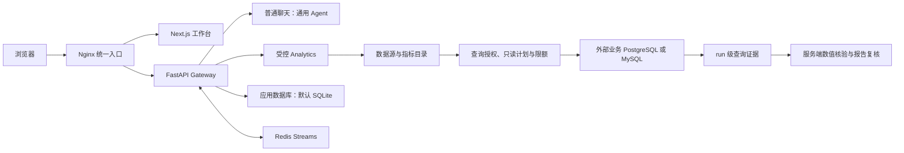

# InsightFlow

[中文](README.md) | [English](README_en.md)

InsightFlow 是一个由个人持续开发的经营分析工作台，帮助团队用内部数据回答业务问题。它把数据目录、服务端授权、只读查询、证据核验和报告发布放在同一条可追溯的流程中。

> 截至 2026-10-09 的交付记录显示，功能和部署门禁按批准范围通过；远程 CI 尚未核验。验收范围与证据见[最终交付状态](docs/acceptance/2026-10-09-final-delivery.md)。

## 功能与操作

首次使用者在 `/setup` 创建首位管理员，之后从 `/login` 登录。工作台入口如下：

| 页面 | 用途 |
| --- | --- |
| `/workspace/analysis/new` | 提交经营问题，启动受控分析；页面不提供数据源或指标选择器 |
| `/workspace/chats` | 浏览当前账号可见的会话，可切换活动和归档视图 |
| `/workspace/chats/new` | 开始普通聊天，使用通用 Agent |
| `/workspace/datasources` | 查看已登记数据源；管理员可维护配置与 schema snapshot |
| `/workspace/metrics` | 查看自己拥有或获明确授权的指标；管理员可管理定义和授权 |
| `/workspace/reports` | 查看已发布报告并打开相关会话 |
| `/workspace/history` | 查看当前账号可见的审计历史 |
| `/workspace/scheduled-tasks` | 创建和查看定时任务；后台调度还需启用 `scheduler.enabled` |

普通聊天从 `/workspace/chats/new` 开始，使用通用 Lead Agent；按运维配置可调用工具、委派 task 子 Agent、使用 MCP、Skills、沙箱与 Memory，并通过 checkpoint 记录运行状态、以 SSE 推送过程。可用能力取决于部署配置。受控 Analytics 是独立流程：Lead 按固定职责协调 SQL Analyst（受限查询准备）和 Data（证据与数值计划），随后由 Report Writer 编写报告、无工具 Reviewer 复核。

数据源和指标页面可以把内容带入新的分析草稿。草稿可编辑，只有用户提交后才会运行。服务器会重新读取当前账号可访问的目录并执行授权检查，浏览器提供的资源 ID 不会扩大访问范围。

## 架构



Analytics 查询需通过语法与语义策略检查、只读执行、结果限额和审计；Gateway 使用 `Decimal` 核验 Data 提交的数值运算计划。阶段面板只展示允许公开的摘要，不显示原始 SQL 或结果行。

普通聊天的 MCP、扩展和沙箱不受 Analytics SQL 授权保护。它们会以 Gateway 权限运行或被调用，只配置可信来源。Local sandbox 使用 Gateway 主机权限，不是容器隔离。

## 部署

默认 Docker Compose 启动四个容器：Nginx、Frontend、Gateway 和 Redis。Redis 为内部 Streams bridge；只有 Nginx 对外发布端口，默认入口是 `http://localhost:2026`，绑定到本机回环地址。`make dev` 则启动 Gateway、Frontend 和 Nginx 三个本机进程。

Gateway 的应用数据库默认是 SQLite，文件位于 `backend/.deer-flow/data/deerflow.db`。也可显式配置外部 PostgreSQL 作为应用数据库。业务 PostgreSQL/MySQL 是另外登记的数据源，不包含在默认 Compose 中。

没有 Make 时，可直接用 `scripts/deploy.sh` 部署默认 Docker 栈。在仓库根目录执行以下命令：

以下复制命令只用于首次部署且目标文件尚不存在时。若本地文件已存在，不要覆盖；保留文件并按需编辑。

```sh
cp .env.example .env
cp frontend/.env.example frontend/.env
cp config.example.yaml config.yaml
cp extensions_config.example.json extensions_config.json
```

在 `config.yaml` 的 `models` 下配置所需模型条目，并在根目录 `.env` 填入对应 provider 所需的 key，然后运行：

```sh
bash scripts/deploy.sh
```

脚本构建并启动默认四容器，等待 Gateway readiness 检查通过后再报告成功。它会生成并持久保存认证密钥。浏览器打开 <http://localhost:2026>，进入 `/setup` 创建管理员。停止服务并保留应用数据和 Redis 数据卷：

```sh
bash scripts/deploy.sh down
```

部署脚本需要 Bash、Docker Compose V2（支持 `docker compose up --wait`），以及 Python 3 或 OpenSSL 以生成并保存密钥。Windows 用户可在 Git Bash 中运行。Make 是可选封装：`make setup` 配置模型，`make up` 启动 Docker 栈，`make down` 停止并移除容器与网络。

源码开发使用 `make install` 后运行 `make dev`；`make start` 运行本机优化模式，`make stop` 停止本机进程。Docker 开发环境使用 `make docker-start`、`make docker-stop` 和 `make docker-logs`。仓库另有可选的 PostgreSQL 演示 Compose 配置，在四个默认容器之外增加业务数据库，共五个容器；配置细节见[本机 PostgreSQL 试用记录](docs/LOCAL_TRIAL.md)。

## 首次使用与授权

1. 管理员在 `/setup` 创建账号后，登记外部业务数据源、发布 schema snapshot，并通过服务端 `secret_ref` 引用只读凭据；再维护指标定义、负责人和口径，分别配置数据源访问策略与指标授权。指标授权不会自动授予业务数据访问权。
2. 用户从 `/login` 登录，可在 `/workspace/chats/new` 开始普通聊天，或在 `/workspace/analysis/new` 提交受控分析。比如可以尝试询问“上月销售额按区域如何变化”；实际可回答范围取决于已授权目录、配置和数据。
3. 分析运行页会显示阶段进度。只有查询、证据核验和报告复核完成后，报告才会出现在 `/workspace/reports`；有权限的用户可下载报告，并在 `/workspace/history` 查看可见的审计记录。

## 常见问题

- **Agent 无法调用模型：** 确认 `config.yaml` 的 `models` 中已配置所需模型条目，并在根目录 `.env` 设置对应 provider key。复制示例文件本身不会选择模型或提供凭据。
- **数据源或指标列表为空：** 检查管理员是否登记了数据源、发布 schema snapshot，并为当前账号配置相应策略和指标授权。
- **报告列表为空：** 只有完成证据核验与报告复核的运行会发布报告。
- **定时任务没有自动运行：** 在 `config.yaml` 中启用 `scheduler.enabled`。
- **应用数据库与业务数据库是什么关系：** 应用 SQLite 保存 Gateway 状态；业务 PostgreSQL/MySQL 是单独登记的分析数据源。

## 文档

- [当前功能与验收证据](docs/current-capabilities.md)
- [Analytics 架构概览](docs/architecture/insightflow-overview.md)
- [安装与运行指南](Install.md)（Windows、Git Bash、各部署模式与故障排查）
- [最终交付状态](docs/acceptance/2026-10-09-final-delivery.md)与[发布验收场景](docs/acceptance/acceptance-scenarios.md)
- [后端指南](backend/AGENTS.md) · [前端指南](frontend/AGENTS.md) · [安全政策](SECURITY.md)

## 许可证与来源

许可证和代码来源记录见 [LICENSE](LICENSE) 与 [UPSTREAM.md](UPSTREAM.md)，适用组件的原始版权及许可声明均予以保留。首页图像不是工作台截图；EHT M87* 图标为第三方素材，项目不暗示 EHT 或 ESO 为 InsightFlow 背书。署名与许可见[素材说明](frontend/public/images/BLACK-HOLE-CREDITS.md)。
