# InsightFlow

[中文](README.md) | [English](README_en.md)

InsightFlow 是个人开发、面向企业经营分析工作流的全栈项目。它把自然语言分析入口、已登记的数据目录、服务端访问策略、只读 SQL 执行、可追溯证据和受控报告发布串成一条可以检查的路径。


## 产品定位

InsightFlow 面向需要用内部数据回答经营问题的团队。产品重点是把“谁能查什么、查询如何执行、结论依据哪些数据、报告何时发布”变成可审查的应用流程。它是一个持续迭代的个人开发项目，面向企业分析场景组织数据治理、Agent 流程和报告交付。

受控分析和普通聊天是两条不同的运行路径：Analytics 使用固定的服务端工具、数据目录和授权查询链；普通聊天使用通用 Lead Agent，可按运维配置接入任务委派、MCP 与 Skills。普通聊天的工具不会因此自动获得 Analytics 的数据访问保护。

> **当前验收状态（2026-10-09）：** 按批准范围，功能与部署门禁均已通过。最新 scheduled run 在 server-computation1109 Gateway 上完成授权查询、服务端数值校验、报告复核和发布；29384 原入口滚动部署的独立后验收也通过。旧失败 run 和 Reviewer 拒绝记录仍保留。Windows 7 门禁、14 个适用候选检查及 `sharedproxy=True` 复验均已通过。Root 已接受最终源码与暂存审查；本状态记录截于发布提交前，commit/push 状态以 Git 记录为准，远程 CI 结果以 Actions 为准（本记录形成时尚未运行）。详见[最终交付状态](docs/acceptance/2026-10-09-final-delivery.md)和[发布证据矩阵](docs/acceptance/2026-10-09-final-release-matrix.md)。

## 首页与演示资源


上图是仓库已有的首页视觉素材，不是工作台截图。仓库目前没有随项目发布的登录后界面截图或演示视频；启动本机栈后可在浏览器中查看真实页面。首页标签图标使用 EHT M87* 照片，署名、改编方式和许可见[视觉资源说明](frontend/public/images/BLACK-HOLE-CREDITS.md)。

## 用户界面与操作流程

首次部署者在 `/setup` 创建首位管理员；日常用户通过 `/login` 登录。工作台目前包含以下入口：

| 入口 | 用途 |
| --- | --- |
| `/workspace/analysis/new` | 新建受控分析；用户提交自然语言问题，页面随后创建 analysis 类型会话 |
| `/workspace/chats` | 普通聊天会话列表；与 Analytics 授权链分开 |
| `/workspace/datasources` | 查看已登记数据源；管理员可使用管理面板维护配置 |
| `/workspace/metrics` | 查看当前主体拥有或获明确授权的指标定义；管理员可维护定义和授权 |
| `/workspace/reports` | 查看已发布报告并打开对应分析会话 |
| `/workspace/history` | 查看当前主体的审计历史；管理员另有按主体查询入口 |
| `/workspace/scheduled-tasks` | 创建和查看定时任务；后台调度还需在配置中启用 |

分析页是普通聊天 composer 的受控模式，没有独立表单，也没有数据源或指标选择器。分析运行由服务端 `inspect_business_catalog` 查询当前主体可访问的目录；Analytics 工具再按当前主体执行授权检查。数据源和指标授权因此不会由浏览器输入的 ID 取代。

数据源和指标目录提供了进入新建分析草稿的预填快捷入口。预填内容可继续编辑，只有用户明确提交后才会运行。目录入口、资源预填、草稿编辑和零运行请求的浏览器探针已通过；当前 Gateway 实例与部署证据另见[最终交付状态](docs/acceptance/2026-10-09-final-delivery.md)。

管理员的常见配置顺序是：登记业务数据源并发布 schema snapshot、通过服务端 `secret_ref` 引用连接凭据、定义指标负责人和口径，再按主体配置数据源策略与指标授权。普通用户只能看到自己可访问的数据源和已拥有或获授权的 active 指标，然后提出经营问题。完整通过查询、证据校验和报告复核的 run 才能进入报告列表；用户可下载报告，并在历史页查看审计。阶段面板只显示合同允许的摘要，不展示原始 SQL 或结果行。

## 分析架构与数据流

```mermaid
flowchart LR
  Browser[浏览器] --> Nginx[Nginx 统一入口]
  Nginx --> Frontend[Next.js 工作台]
  Nginx --> Gateway[FastAPI Gateway]
  Frontend -->|REST 与 SSE| Gateway
  Gateway --> Admission[身份、analysis kind 与 run 能力校验]
  Admission --> Catalog[可访问数据源与 active 指标目录]
  Catalog --> SQLRole[SQL Analyst 与查询计划]
  SQLRole --> Policy[SQL AST 与语义授权、只读限额]
  Policy --> BusinessDB[外置业务 PostgreSQL 或 MySQL]
  BusinessDB --> Evidence[按 owner、thread、run 绑定的查询证据]
  Evidence --> DataRole[Data 阶段与数值声明核验]
  DataRole --> Writer[固定报告模板与有界 Reviewer]
  Writer --> Artifact[报告索引与 owner-check 下载]
  Gateway --> AppDB[应用数据库：默认 SQLite，可选 PostgreSQL]
```



Gateway 托管 Analytics 应用与嵌入式通用 Agent runtime。Analytics 采用 `domain`、`application`、`infrastructure`、`agent`、`api` 分层；Harness 包提供通用 Agent 执行机制，依赖方向由 App 指向 Harness。普通聊天使用通用 Lead Agent；受控分析由 Lead 编排，调用 SQL Analyst 形成受控查询。Data role 输出绑定 run-scoped evidence 单元格的 `NumericClaimPlan` 运算与引用；Gateway domain verifier 解析快照并使用 `Decimal` 计算和校验数值，模型输出不是算术结果的权威来源。报告 Writer 和有界 Reviewer 完成报告发布。当前分析模式只接纳三个固定工具：`inspect_business_catalog`、`query_business_data`、`write_analysis_report`，并关闭通用 subagent、Skills、Memory 和 plan mode。

受控 SQL 路径先读取当前主体可见目录，再由 SQL Analyst 形成查询计划。Gateway 重新校验 owner、数据源、表列与函数策略，并在只读事务中执行查询；行数、字节数和时限有上限，审计写入失败时不继续放行。查询快照以 evidence ID 绑定到当前 run，Data 阶段按证据单元格核验数字声明，之后才允许报告写入流程。报告使用固定渲染器，并经过有界、无工具的模型复核；这些步骤提高可追溯性，不等同于证明所有经营口径天然正确。

阶段事件采用受限合同并保存在 Gateway 持久事件流中，分析页面可以显示运行阶段和允许的摘要字段。它不展示 SQL、结果行、模型自由文本或思维链。run checkpoint 与消息状态由 LangGraph/Gateway 持久化机制管理；持久化能力是否可用及多实例部署约束取决于应用配置。

### Agent 运行时与产品新增边界

| 部分 | 当前用途 |
| --- | --- |
| 通用 Agent runtime | Lead、模型和工具接入、MCP、Skills、task 子代理、沙箱、Memory、checkpoint 与运行时机制；具体启用情况由配置决定 |
| InsightFlow Analytics | 数据源和指标目录、主体授权、SQLGlot 语法与语义策略、只读执行计划、durable evidence、Data 数值声明核验、阶段事件和受控报告发布 |
| Gateway / Next.js 工作台 | 认证与 owner 隔离、统一 API/SSE、管理入口、报告和审计页面、持久化与前端阶段展示 |

分析链中的 SQL Analyst 与 Data 是有界的独立角色调用；Report Writer 使用 run-scoped 写入能力，Reviewer 是发布前的有界零工具复核。Metric Service 提供指标口径快照。普通聊天 MCP 调用与受控 Analytics 查询使用不同的授权边界。MySQL adapter 保留为可选支持；当前 live 验收要求的业务数据库是 PostgreSQL。

## 数据库与服务部署

Gateway 的**应用数据库**默认是 SQLite，默认 Docker 部署将数据持久化到 Gateway 数据目录。运维人员也可以明确配置外部 PostgreSQL 作为应用数据库。应用数据库保存 Gateway 持久状态、run/event 与 checkpoint 相关数据。

**业务数据库**是另外配置的数据源，不包含在默认 Compose 中。当前受控查询验收以 PostgreSQL 为必验目标，MySQL adapter/usecase 是可选支持。默认四服务中的 Redis 用于内部 Redis Streams bridge，不是业务数据库或应用数据库。

默认 Docker Compose 只运行四个容器：

| 服务 | 端口 | 作用 |
| --- | --- | --- |
| Nginx | `2026` | 唯一对外入口；转发 API 并提供前端 |
| Frontend | `3000` | Next.js 工作台，由 Nginx 对外服务 |
| Gateway | `8001` | FastAPI REST API、Analytics 与 Agent runtime |
| Redis | `6379` | Compose 网络内的 Redis Streams bridge；默认不发布宿主机端口 |

默认仅将 Nginx 入口绑定到本机回环地址。业务数据库不属于这四个服务。`make dev` 则启动 Gateway、Frontend 和 Nginx 三个面向本机开发的进程。

## 本机启动

默认 Docker 部署需要 Docker Desktop 与 Compose、`make`、Python 3.12+ 和 `uv`。前端源码开发还需要 Node.js 22+ 与 pnpm 10.26.2+。首次使用可在交互式终端从仓库根目录运行：

```sh
make setup
make up
```

`make setup` 交互配置模型；需要手工配置时改用 `make config` 生成模板，再编辑 `config.yaml` 和根目录 `.env`。也可先运行 `make check` 查看本机依赖。打开 <http://localhost:2026>，在 `/setup` 创建首位管理员。Docker 默认入口绑定 `127.0.0.1:2026`；`make down` 停止并移除容器和网络，保留持久数据卷。

源码开发先运行 `make install` 安装依赖，再运行 `make dev` 启动 Gateway、Frontend 和本机 Nginx。`make start` 启动本机优化模式，`make stop` 停止本机进程。`SKIP_FRONTEND_BUILD=1 make start` 只在已有 `frontend/.next/BUILD_ID` 构建时复用前端产物。Docker 开发使用 `make docker-start` / `make docker-stop`；Docker 生产部署使用 `make up` / `make down`。完整安装、Windows PowerShell 的实际脚本等效命令和常见问题见[安装与运行指南](Install.md)。

`make config` 只复制示例配置，不会选择模型或生成 Provider key；只有有效的 `config.yaml -> models[]` 与提供方要求的凭据都配置好，Agent 才能发起模型调用。数据源密码通过服务端 `secret_ref` 引用。不要提交 `config.yaml`、`extensions_config.json`、`.env` 或前端环境文件。

MCP server、Python extensions、模型 Provider 和 sandbox endpoint 都会以 Gateway 进程权限运行或被调用，只配置可信来源。Local sandbox 命令具有 Gateway 主机权限，不应被描述为强容器隔离。默认只通过 Nginx 访问 Gateway，不要将其端口发布到公网。

## 常见空目录状态

- **数据源为空：** 管理员尚未登记数据源，或当前账号没有可见的数据源。
- **指标目录为空：** 尚无 active 指标，或定义未归属当前主体、未授权给当前主体；草稿和下线指标不会出现在普通目录。
- **报告列表为空：** 尚无成功完成证据与报告复核的 run；报告页展示已发布项目。
- **审计历史为空：** 当前账号尚未产生可见的审计记录；管理员主体查询也只在有记录时显示内容。
- **定时任务为空：** 尚未创建任务；后台自动调度还需要 `scheduler.enabled` 配置为启用。

受控分析 composer 没有数据源或指标 picker。即使目录页面显示内容，分析服务端仍以当前主体的目录和策略决定可访问范围。

## 开发入口与说明

- [当前功能与验收证据](docs/current-capabilities.md)
- [最终交付状态与剩余门禁](docs/acceptance/2026-10-09-final-delivery.md)
- [Analytics 架构概览](docs/architecture/insightflow-overview.md)
- [安装与运行指南](Install.md)
- [后端指南](backend/AGENTS.md) · [前端指南](frontend/AGENTS.md)
- [完整发布验收场景](docs/acceptance/acceptance-scenarios.md)
- [安全政策](SECURITY.md)
- [历史本机 PostgreSQL 试用与验收记录](docs/LOCAL_TRIAL.md)

## 开源许可证与来源

项目的开源许可证与代码来源记录见 [LICENSE](LICENSE) 和 [UPSTREAM.md](UPSTREAM.md)；适用组件的原始版权与许可声明均予以保留。EHT M87* 图片为第三方图像，项目不暗示 EHT 或 ESO 为 InsightFlow 背书；适用许可和署名方式见[素材说明](frontend/public/images/BLACK-HOLE-CREDITS.md)。
