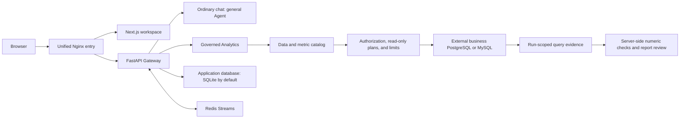

# InsightFlow

[简体中文](README.md) | [English](README_en.md)

InsightFlow is an individually developed workspace for business analysis with internal data. It brings the data catalog, server-side authorization, read-only queries, evidence checks, and report publishing into one traceable workflow.

> The delivery record dated 2026-10-09 marks the functional and deployment gates as passed within the approved scope. Remote CI has not been verified. See the [final delivery status](docs/acceptance/2026-10-09-final-delivery.md) for scope and evidence.

## Features and workflows

On first use, create the initial administrator at `/setup`, then sign in at `/login`. The workspace provides these pages:

| Page | Purpose |
| --- | --- |
| `/workspace/analysis/new` | Submit a business question for governed analysis; there is no data-source or metric picker |
| `/workspace/chats` | Browse threads visible to the signed-in user, with active and archived views |
| `/workspace/chats/new` | Start an ordinary chat with the general Agent |
| `/workspace/datasources` | View registered data sources; administrators can manage configuration and schema snapshots |
| `/workspace/metrics` | View metrics owned by or explicitly granted to the user; administrators can manage definitions and grants |
| `/workspace/reports` | View published reports and open their related threads |
| `/workspace/history` | View audit history available to the signed-in user |
| `/workspace/scheduled-tasks` | Create and view scheduled tasks; background scheduling also requires `scheduler.enabled` |

Ordinary chat at `/workspace/chats/new` uses the general Lead Agent. Depending on operator configuration, it can call tools, delegate task subagents, and use MCP, Skills, sandboxes, and Memory; checkpoints record run state, and SSE streams progress. Available capabilities depend on deployment configuration. Governed Analytics is a separate workflow: Lead coordinates fixed SQL Analyst (bounded query preparation) and Data (evidence and numeric plan) roles, followed by report writing from Report Writer and review by a tool-free Reviewer.

The data-source and metric pages can prefill a new analysis draft. Users can edit it, and the analysis runs only after submission. The server loads the current user's accessible catalog and checks authorization again, so browser-supplied resource IDs cannot expand access.

## Architecture



Analytics queries pass syntax and semantic checks, run read-only with result limits, and are audited. The Gateway verifies the Data stage's evidence-linked numeric plan with `Decimal`. The stage panel shows only permitted summaries, not raw SQL or result rows.

Ordinary-chat MCP, extensions, and sandboxes do not inherit Analytics SQL protections. They run with or are called by the Gateway process, so configure trusted sources only. Local sandbox commands use the Gateway host's privileges; they are not container isolation.

## Deployment

The default Docker Compose stack has four containers: Nginx, Frontend, Gateway, and Redis. Redis backs the internal Streams bridge. Only Nginx publishes a host port; the default entry is `http://localhost:2026` and binds to the loopback interface. `make dev` starts three local processes: Gateway, Frontend, and Nginx.

The Gateway application database defaults to SQLite at `backend/.deer-flow/data/deerflow.db`. An external PostgreSQL database can be configured for application state. Business PostgreSQL/MySQL databases are separate registered data sources and are not part of the default Compose stack.

To deploy the default Docker stack without Make, run these commands from the repository root:

Copy these files only for a first deployment when the targets do not exist. If a local file already exists, do not overwrite it; keep it and edit it as needed.

```sh
cp .env.example .env
cp frontend/.env.example frontend/.env
cp config.example.yaml config.yaml
cp extensions_config.example.json extensions_config.json
```

Configure the required model entry under `models` in `config.yaml` and add its provider key to the root `.env`, then run:

```sh
bash scripts/deploy.sh
```

The script builds and starts the four default containers, then waits for the Gateway readiness check before reporting success. It generates and persists the authentication secrets. Open <http://localhost:2026> and create the administrator at `/setup`. To stop the services while keeping application data and the Redis data volume, run:

```sh
bash scripts/deploy.sh down
```

The deployment script requires Bash, Docker Compose V2 with `docker compose up --wait` support, and Python 3 or OpenSSL to generate and save secrets. On Windows, run it in Git Bash. Make is an optional wrapper: `make setup` configures a model, `make up` starts Docker, and `make down` removes the containers and network.

For source development, run `make install` and then `make dev`; `make start` runs the optimized local mode and `make stop` stops local processes. The Docker development environment uses `make docker-start`, `make docker-stop`, and `make docker-logs`. The repository also includes an optional PostgreSQL demo Compose configuration that adds a business database to the four default containers, for five containers total; see the [local PostgreSQL trial record](docs/LOCAL_TRIAL.md).

## First use and authorization

1. The administrator creates the initial account at `/setup`, registers an external business data source, publishes its schema snapshot, and references read-only credentials through server-side `secret_ref`. The administrator then defines metrics, owners, and semantics, and configures data-source policies and metric grants separately. A metric grant does not grant access to its business data source.
2. Users sign in at `/login` and choose ordinary chat at `/workspace/chats/new` or governed analysis at `/workspace/analysis/new`. For example, they can ask how sales last month varied by region; the answerable scope depends on the authorized catalog, configuration, and data.
3. The analysis page shows stage progress. A report appears at `/workspace/reports` only after the query, evidence checks, and report review complete. Users with access can download it and inspect visible audit history at `/workspace/history`.

## Common questions

- **The Agent cannot call a model:** Configure the required model entry under `models` in `config.yaml` and set its provider key in the root `.env`. Copying the example files does not select a model or supply credentials.
- **The data-source or metric list is empty:** Ask an administrator to register the data source, publish its schema snapshot, and configure the relevant policy and metric grant.
- **There are no reports:** Only runs that pass evidence checks and report review publish a report.
- **Scheduled tasks do not run automatically:** Enable `scheduler.enabled` in `config.yaml`.
- **How are the application and business databases different?** The application SQLite database stores Gateway state. Business PostgreSQL/MySQL databases are separately registered data sources for analysis.

## Documentation

- [Current capabilities and acceptance evidence](docs/current-capabilities.md)
- [Analytics architecture overview](docs/architecture/insightflow-overview.md)
- [Install and run](Install.md) — Windows, Git Bash, deployment modes, and troubleshooting
- [Final delivery status](docs/acceptance/2026-10-09-final-delivery.md) and [release acceptance scenarios](docs/acceptance/acceptance-scenarios.md)
- [Backend guide](backend/AGENTS.md) · [Frontend guide](frontend/AGENTS.md) · [Security policy](SECURITY.md)

## License and provenance

Licensing and code provenance are documented in [LICENSE](LICENSE) and [UPSTREAM.md](UPSTREAM.md). Original copyright and license notices for applicable components are retained. The landing-page image is not a workspace screenshot. The EHT M87* favicon is a third-party asset; InsightFlow does not imply endorsement by the EHT Collaboration or ESO. See the [visual asset credits](frontend/public/images/BLACK-HOLE-CREDITS.md) for attribution and license terms.
