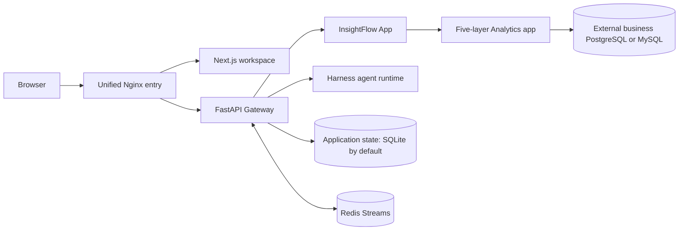

# InsightFlow

[简体中文](README.md) | [English](README_en.md)

InsightFlow is an agent workspace I designed and built around analysis of internal business data. It uses a LangGraph agent runtime to connect the data catalog, server-side authorization, evidence checks, and report publishing in a traceable flow, while retaining a general tool loop and task subagents for ordinary chat.

> The 2026-10-10 acceptance snapshot records six successful GitHub Actions workflows for commit `b40ea6b497b6559eb0731cb6f370f53085fbd33d` and a successful local deployment review. It describes that commit at that time; see the [acceptance snapshot](docs/acceptance/2026-10-10-ci-final-acceptance.md) for its scope and evidence.

## Project highlights

- **A governed analytics product on a general runtime:** InsightFlow App is separated from the reusable Harness, with server-side contracts for catalogs, authorization, read-only queries, evidence, and report publishing.
- **Reports tied to query evidence:** Results are scoped to a run; Data submits a numeric plan referencing evidence cells, the Gateway recalculates it with `Decimal`, and a fixed Writer and tool-free Reviewer complete the publishing path.
- **Two distinct agent paths:** Ordinary chat retains a general tool loop and configurable extensions. Analytics uses a fixed tool set and bounded role calls to keep model behavior inside product authorization.
- **A complete workspace flow:** The UI covers data sources, metrics, analysis traces, report downloads, conversations, audit history, and scheduled tasks.

## Technology stack

| Layer | Technology |
| --- | --- |
| Web workspace | Next.js, React, TypeScript |
| Unified entry | Nginx reverse proxy |
| Gateway and product app | Python, FastAPI |
| Agent runtime | LangGraph, InsightFlow Harness |
| Query and storage | SQLGlot, external PostgreSQL/MySQL, application SQLite; Redis Streams for internal event bridging |
| Local delivery | Docker Compose or Make-driven local services |

## Features and workflows

On first use, create the initial administrator at `/setup`, then sign in at `/login`. The workspace provides these pages:

| Page | Purpose |
| --- | --- |
| `/workspace/analysis/new` | Submit a business question for governed analysis; there is no data-source or metric picker |
| `/workspace/chats` | Browse threads visible to the signed-in user, with active and archived views |
| `/workspace/chats/new` | Start an ordinary chat with the general Agent |
| `/workspace/datasources` | View registered data sources; administrators can manage configuration and schema snapshots |
| `/workspace/metrics` | View metrics owned by or explicitly granted to the user; administrators can manage definitions and grants |
| `/workspace/reports` | View published reports and open their related threads |
| `/workspace/history` | View audit history available to the signed-in user |
| `/workspace/scheduled-tasks` | Create and view scheduled tasks; background scheduling also requires `scheduler.enabled` |

## Agent capabilities

### Ordinary chat

Ordinary chat runs a general Lead Agent tool loop. When `task` is enabled, the Lead can delegate bounded work to task subagents. Each delegation gets a separate execution identity and is governed by a queue, concurrency limit, timeout, token budget, cancellation, and result receipt. Defaults are 3 running tasks, 64 queued tasks, and a 300-second queue wait; operators can configure them.

The following capabilities depend on operator configuration and deployment settings:

| Capability | Purpose |
| --- | --- |
| MCP | Connects external tools through MCP; long-running work is tracked by the Gateway's durable task service and can be recovered. |
| Skills | Discovers and loads reusable task instructions; specific content can be searched and read on demand instead of keeping every instruction in context. |
| Memory and summaries | Persistent memory can extract, update, and retrieve cross-session information; summarization condenses older messages at configured thresholds while retaining recent context. |
| Sandbox | Local file and command tools use Gateway host privileges and do not provide isolation; AIO is a client for an external sandbox service, whose isolation boundary is determined by that service. InsightFlow does not run the AIO server. |
| Plan and clarification | Ordinary chat can use plan mode and interactive clarification; internal non-interactive runs remove the clarification tool. |

Installing the project does not enable all capabilities by default. Local sandbox and extensions run with Gateway privileges, so only trusted sources should be loaded.

The Gateway saves run state in checkpoints and can store events in the application database for history and recovery. SSE streams run and subtask progress to the workspace, while cancellation flows into the corresponding run or subtask lifecycle. Scheduled tasks reuse the ordinary run path and require `scheduler.enabled` in `config.yaml`. Busy occurrences are persisted as `queued`, then move through lease-fenced `launching`; queued work does not consume active-run capacity.

### Governed Analytics

Analytics disables general `task` delegation, Skills, Memory, and general plan mode. The Lead has only three fixed tools: `inspect_business_catalog`, `query_business_data`, and `write_analysis_report`. It calls bounded SQL Analyst and Data roles in the same run, followed by the fixed Writer and tool-free Reviewer publishing steps.

The server loads the catalog and metrics visible to the signed-in user, then SQL Analyst prepares a query. SQLGlot AST checks and semantic authorization must pass before the Gateway issues a short-lived, single-use plan and runs a read-only query with row, byte, time, and audit limits. Raw SQL and result rows are excluded from the stage UI.

Query results become evidence scoped to the current run. The Data role submits a `NumericClaimPlan` referencing evidence cells; the domain verifier recalculates and checks claims with server-side `Decimal`. A fixed Report Writer creates the report, then a bounded tool-free Reviewer checks it before an owner-scoped report is published. SQL Analyst and Data are bounded roles called by the Lead in one run; Writer and Reviewer are fixed publishing steps, not five independent resident agents.

Data-source and metric pages can prefill an analysis draft. Users can edit it, and it runs only after explicit submission. The server reloads the current user's accessible catalog and checks authorization, so browser-supplied resource IDs cannot expand access.

## Architecture and key design



| Component | Responsibility |
| --- | --- |
| Next.js workspace | Provides analysis, chat, catalog, report, audit, and scheduled-task pages; displays server-filtered stage information. |
| Nginx | Serves as the single browser entry, routing page requests to the frontend and API or streaming requests to the Gateway. |
| FastAPI Gateway | Handles authentication, threads, runs, artifacts, SSE, scheduling, and HTTP APIs, and composes the product app with Harness. |
| Harness | Provides the general Lead, tools and middleware, task subagents, MCP, Skills, sandbox, Memory, and checkpoints. The app may depend on Harness; the reverse dependency is prohibited. |
| Analytics domain | Defines contracts for data sources, schemas, policies, metrics, query plans, evidence, and reports. |
| Analytics application | Orchestrates catalog, authorization, query execution, and report-publishing use cases through ports. |
| Analytics infrastructure | Implements SQLite persistence, server-side `secret_ref` resolution, SQL AST and semantic policies, and PostgreSQL/MySQL connectors. |
| Analytics agent | Wraps governed use cases as fixed agent capabilities, registers evidence, organizes numeric claims, and produces reports. |
| Analytics API | Provides HTTP schemas and routers; `composition.py` assembles dependencies. |
| Application SQLite / optional PostgreSQL | Stores Gateway users, threads, runs, events, and Analytics application state. Operators can explicitly switch the application database to PostgreSQL. |
| Redis Streams | Bridges internal streaming events in the default Docker stack; it is not a public entry point. |
| External business PostgreSQL / MySQL | Separately registered by administrators and accessed with read-only credentials; these databases are outside the default Compose stack. |

A governed analysis proceeds in order: authenticate the owner and load their accessible catalog and metrics; resolve `secret_ref` on the server and authorize the SQL AST and semantics; issue a short-lived single-use plan and execute it read-only with limits and audit; bind results to run-scoped evidence; let Data submit a `NumericClaimPlan` for server-side `Decimal` verification; then have the fixed Writer and tool-free Reviewer publish an owner-scoped report. The stage UI receives a safe projection without SQL or result contents.

These boundaries address distinct risks: owner checks prevent cross-account access to threads and reports; server-side `secret_ref` resolution keeps credentials out of the browser; checkpoints and database event storage preserve run state across refreshes and restarts; the Scheduler's durable queue and leases prevent busy work from being lost or launched twice, while queued work stays outside the active-run budget.

## Deployment

The default Docker Compose stack has four containers: Nginx, Frontend, Gateway, and Redis. Redis backs the internal Streams bridge. Only Nginx publishes a host port; the default entry is `http://localhost:2026` and binds to the loopback interface. `make dev` starts three local processes: Gateway, Frontend, and Nginx.

The Gateway application database defaults to SQLite at `backend/.deer-flow/data/deerflow.db`. An external PostgreSQL database can be configured for application state. Business PostgreSQL/MySQL databases are separate registered data sources and are not part of the default Compose stack.

To deploy the default Docker stack without Make, run these commands from the repository root:

Copy these files only for a first deployment when the targets do not exist. If a local file already exists, do not overwrite it; keep it and edit it as needed.

```sh
cp .env.example .env
cp frontend/.env.example frontend/.env
cp config.example.yaml config.yaml
cp extensions_config.example.json extensions_config.json
```

Configure the required model entry under `models` in `config.yaml` and add its provider key to the root `.env`, then run:

```sh
bash scripts/deploy.sh
```

The script builds and starts the four default containers, then waits for the Gateway readiness check before reporting success. It generates and persists the authentication secrets. Open <http://localhost:2026> and create the administrator at `/setup`. To stop the services while keeping application data and the Redis data volume, run:

```sh
bash scripts/deploy.sh down
```

The deployment script requires Bash, Docker Compose V2 with `docker compose up --wait` support, and Python 3 or OpenSSL to generate and save secrets. On Windows, run it in Git Bash. Make is an optional wrapper: `make setup` configures a model, `make up` starts Docker, and `make down` removes the containers and network.

For source development, run `make install` and then `make dev`; `make start` runs the optimized local mode and `make stop` stops local processes. The Docker development environment uses `make docker-start`, `make docker-stop`, and `make docker-logs`. The repository also includes an optional PostgreSQL demo Compose configuration that adds a business database to the four default containers, for five containers total; see the [local PostgreSQL trial record](docs/LOCAL_TRIAL.md).

## First use and authorization

1. The administrator creates the initial account at `/setup`, registers an external business data source, and publishes its schema snapshot. Read-only credentials are referenced with server-side `secret_ref`. The administrator then defines metric semantics and owners and configures data-source policies and metric grants separately. A metric grant does not grant access to its business data source.
2. After signing in at `/login`, users can bring authorized content from a data-source or metric page into a new analysis draft, edit the question, and explicitly submit it. They can also submit directly at `/workspace/analysis/new` or start ordinary chat at `/workspace/chats/new`.
3. The analysis page shows a safe stage trace. After query, evidence, and report review complete, users can open and download the owner report at `/workspace/reports`, return to its related thread, and inspect visible audit history at `/workspace/history`.
4. Ordinary chat can call configured tools or task subagents and show tool progress and generated artifacts. Background schedules can be created at `/workspace/scheduled-tasks` when the Gateway has `scheduler.enabled` turned on.

## Common questions

- **The Agent cannot call a model:** Configure the required model entry under `models` in `config.yaml` and set its provider key in the root `.env`. Copying the example files does not select a model or supply credentials.
- **The data-source or metric list is empty:** Ask an administrator to register the data source, publish its schema snapshot, and configure the relevant policy and metric grant.
- **There are no reports:** Only runs that pass evidence checks and report review publish a report.
- **Scheduled tasks do not run automatically:** Enable `scheduler.enabled` in `config.yaml`.
- **How are the application and business databases different?** The application SQLite database stores Gateway state. Business PostgreSQL/MySQL databases are separately registered data sources for analysis.

## Documentation

- [Current capabilities and acceptance evidence](docs/current-capabilities.md)
- [2026-10-10 CI and local deployment acceptance snapshot](docs/acceptance/2026-10-10-ci-final-acceptance.md)
- [Analytics architecture overview](docs/architecture/insightflow-overview.md)
- [Install and run](Install.md) — Windows, Git Bash, deployment modes, and troubleshooting
- [Final delivery status](docs/acceptance/2026-10-09-final-delivery.md) and [release acceptance scenarios](docs/acceptance/acceptance-scenarios.md)
- [Backend guide](backend/AGENTS.md) · [Frontend guide](frontend/AGENTS.md) · [Security policy](SECURITY.md)

## License and provenance

Licensing and code provenance are documented in [LICENSE](LICENSE) and [UPSTREAM.md](UPSTREAM.md). Original copyright and license notices for applicable components are retained. The landing-page image is not a workspace screenshot. The EHT M87* favicon is a third-party asset; InsightFlow does not imply endorsement by the EHT Collaboration or ESO. See the [visual asset credits](frontend/public/images/BLACK-HOLE-CREDITS.md) for attribution and license terms.
