# InsightFlow

[简体中文](README.md) | English

InsightFlow is an individually developed, full-stack workspace for governed business analysis. It connects a natural-language analysis entry point to a registered data catalog, server-side access policies, read-only SQL execution, traceable evidence, and reviewed report publishing.

## Product position

InsightFlow is designed for teams that answer business questions with internal data. Its focus is to make who can query what, how queries are executed, which evidence supports a conclusion, and when a report is published visible and reviewable.

Governed Analytics and ordinary chat follow separate paths. Analytics uses a fixed server-side toolset, catalog, and authorization flow. Ordinary chat uses a general Lead Agent and may use task delegation, MCP, and Skills when operators enable them. Ordinary chat tools do not inherit Analytics data-access protections.

> **Acceptance status (2026-10-09):** Functional and deployment gates have passed within the approved scope. The latest scheduled run on the `server-computation1109` Gateway completed its authorized query, server-side numeric verification, report review, and publish, producing an owner report; independent postchecks for the original entry rollout at `29384` also passed. Earlier failed runs and Reviewer rejections remain recorded. Seven Windows gates, the merged set of 14 applicable candidate checks, and the `sharedproxy=True` recheck passed; the focused recheck returned 1 passed, 6 deprecation warnings, in 16.75 seconds. Root accepted the final source and staged review. This status snapshot predates the release commit; commit/push state is recorded in Git, and remote CI status belongs to Actions (CI had not run when this record was written). See the [final delivery status](docs/acceptance/2026-10-09-final-delivery.md) and [release evidence matrix](docs/acceptance/2026-10-09-final-release-matrix.md).

## Landing page and demo assets


The image above is an existing visual asset for the landing page, not a screenshot of the workspace. The repository does not include an authenticated-workspace screenshot or a demo video; start the local stack to view the actual product UI. The favicon uses a third-party EHT M87* image. Its attribution, permitted adaptation, and license are documented in the [visual asset credits](frontend/public/images/BLACK-HOLE-CREDITS.md).

## Workspace and user flow

First-time operators create the initial administrator at `/setup`; daily users sign in at `/login`. The workspace currently has these entry points:

| Route | Purpose |
| --- | --- |
| `/workspace/analysis/new` | Start governed analysis; submitting a natural-language question creates an analysis thread |
| `/workspace/chats` | Browse ordinary chat threads, separate from the Analytics authorization flow |
| `/workspace/datasources` | View registered data sources; administrators can maintain their configuration |
| `/workspace/metrics` | View metrics owned by or explicitly granted to the current principal; administrators can manage definitions and grants |
| `/workspace/reports` | View published reports and open their analysis threads |
| `/workspace/history` | View audit history visible to the current principal; administrators also have a principal-scoped view |
| `/workspace/scheduled-tasks` | Create and view scheduled tasks; background scheduling also requires configuration to be enabled |

The analysis page is a controlled mode of the ordinary chat composer. It has no separate form or data-source/metric picker. The server uses `inspect_business_catalog` to read the current principal's accessible catalog, and Analytics tools check authorization again. IDs supplied by the browser cannot replace data-source or metric authorization.

The data-source and metric catalogs can prefill a new-analysis draft. Users can edit the draft; an analysis runs only after explicit submission. Browser probes have passed for catalog navigation, resource prefill, draft editing, and zero run requests before submission. Current Gateway and deployment evidence is summarized in the [final delivery status](docs/acceptance/2026-10-09-final-delivery.md).

A typical administrator setup is to register a business data source and publish a schema snapshot, reference its connection credential through server-side `secret_ref`, define metric ownership and semantics, then configure data-source policies and metric grants by principal. Ordinary users see only data sources they can access and active metrics they own or have been granted. A run appears in Reports only after its query, evidence validation, and report review succeed. Users can download reports and inspect audit history; the stage panel shows only fields allowed by its contract, not raw SQL or result rows.

## Analytics architecture and data flow

```mermaid
flowchart LR
  Browser[Browser] --> Nginx[Unified Nginx entry]
  Nginx --> Frontend[Next.js workspace]
  Nginx --> Gateway[FastAPI Gateway]
  Frontend -->|REST and SSE| Gateway
  Gateway --> Admission[Identity, analysis kind, and run capability checks]
  Admission --> Catalog[Accessible data-source and active-metric catalog]
  Catalog --> SQLRole[SQL Analyst and query plan]
  SQLRole --> Policy[SQL AST and semantic authorization, read-only limits]
  Policy --> BusinessDB[External business PostgreSQL or MySQL]
  BusinessDB --> Evidence[Query evidence scoped to owner, thread, and run]
  Evidence --> DataRole[Data stage and numeric-claim verification]
  DataRole --> Writer[Fixed report template and bounded Reviewer]
  Writer --> Artifact[Report index and owner-checked download]
  Gateway --> AppDB[Application database: SQLite by default, PostgreSQL optional]
```



The Gateway hosts the Analytics app and an embedded general Agent runtime. Analytics is divided into `domain`, `application`, `infrastructure`, `agent`, and `api` layers. The Harness package provides general Agent execution, with the App depending on the Harness. Ordinary chat uses a general Lead Agent. Governed analysis is orchestrated by Lead and uses SQL Analyst to form a controlled query. Data returns a `NumericClaimPlan` with operations and cell references bound to run-scoped evidence. The Gateway domain verifier resolves the evidence snapshot and performs numeric calculation and validation with `Decimal`; model output is not treated as the authoritative arithmetic result. A report Writer and a bounded Reviewer complete report publishing.

The controlled SQL path reads the current principal's visible catalog before SQL Analyst prepares a query plan. The Gateway rechecks ownership and table, column, function, and data-source policies, then executes in a read-only transaction. Row count, payload size, and execution time are bounded. If audit persistence fails, execution is not allowed to continue. Query snapshots are bound to the current run by evidence ID. The fixed report renderer and bounded, tool-free Reviewer improve traceability; they do not prove that every business definition is inherently correct.

Stage events are persisted under a constrained contract. The analysis page displays run stages and permitted summary fields, without SQL, result rows, model free text, or chain-of-thought. LangGraph/Gateway persistence manages run checkpoints and message state; availability and multi-instance constraints depend on application configuration.

### Agent runtime and product boundary

| Area | Current purpose |
| --- | --- |
| General Agent runtime | Lead, model and tool integrations, MCP, Skills, task subagents, sandbox, Memory, checkpoints, and runtime mechanisms; enablement depends on operator configuration |
| InsightFlow Analytics | Data and metric catalogs, principal-scoped authorization, SQLGlot syntax and semantic policies, read-only plans, durable evidence, Data numeric-claim verification, stage events, and controlled report publishing |
| Gateway / Next.js workspace | Authentication and owner isolation, unified API/SSE, administration, report and audit pages, persistence, and stage display |

SQL Analyst and Data are bounded independent role calls. Report Writer uses run-scoped write capability; Reviewer is a bounded, tool-free review before publication. Metric Service supplies a snapshot of metric semantics. Ordinary-chat MCP calls and governed Analytics queries have different authorization boundaries. The MySQL adapter remains optional; PostgreSQL is the required business database for current live acceptance.

## Databases and service deployment

The Gateway application database defaults to SQLite. The default Docker deployment persists it under the Gateway data directory. Operators may explicitly configure an external PostgreSQL application database. This database stores Gateway persistent state, runs, events, and checkpoint-related data.

Business databases are separate registered data sources and are not included in the default Compose stack. PostgreSQL is the required target for current governed-query acceptance; MySQL support is optional. Redis in the default stack backs the internal Redis Streams bridge, not the application or business database.

The default Docker Compose stack has four containers:

| Service | Port | Role |
| --- | --- | --- |
| Nginx | `2026` | Only published entry point; proxies API requests and serves the frontend |
| Frontend | `3000` | Next.js workspace served through Nginx |
| Gateway | `8001` | FastAPI REST API, Analytics, and Agent runtime |
| Redis | `6379` | Internal Redis Streams bridge; no host port is published by default |

By default, only the Nginx entry is bound to the loopback interface. Business databases are not part of these four services. Local `make dev` starts the three application-facing processes: Gateway, Frontend, and Nginx.

## Install and run locally

For the default Docker deployment, install Docker Desktop and Compose, `make`, Python 3.12+, and `uv`. Frontend source development additionally requires Node.js 22+ and pnpm 10.26.2+. From the repository root, an interactive first-time setup can run:

```sh
make setup
make up
```

`make setup` interactively configures a model. For manual setup, run `make config` to create templates, then edit `config.yaml` and the root `.env`. You can also run `make check` to inspect local prerequisites. Open <http://localhost:2026> and create the initial administrator at `/setup`. The default Docker entry binds to `127.0.0.1:2026`. `make down` removes the containers and network while retaining persistent data volumes.

For source development, install dependencies with `make install`, then start the reload-enabled stack with `make dev`. `make start` runs the optimized local mode and builds the frontend by default; `SKIP_FRONTEND_BUILD=1 make start` reuses an existing `frontend/.next/BUILD_ID`. Use `make stop` to stop local processes. Docker development uses `make docker-start` / `make docker-stop`; Docker production uses `make up` / `make down`. The [Install guide](Install.md) has the equivalent Windows PowerShell commands and troubleshooting details.

`make config` copies example files; it does not select a model or create a provider key. The Agent can call a model only when `config.yaml -> models[]` and the provider's required credentials are configured. Business-data credentials are referenced server-side with `secret_ref`. Never commit `config.yaml`, `extensions_config.json`, `.env`, or frontend environment files.

MCP servers, Python extensions, model providers, and sandbox endpoints run with or are called by the Gateway process, so configure trusted sources only. Local sandbox commands have the Gateway host's privileges and should not be described as strong container isolation. By default, access the Gateway through Nginx; do not publish its port to the public internet.

## Common empty states

- **No data sources:** An administrator has not registered any, or the current principal cannot see them.
- **Empty metric catalog:** There is no active metric owned by or explicitly granted to the current principal. Draft and retired metrics are not shown in the ordinary catalog.
- **No reports:** No run has completed evidence validation and report review; the Reports page lists published artifacts.
- **Empty audit history:** The current principal has no visible audit entries. An administrator's principal-scoped view also contains only existing entries.
- **No scheduled tasks:** No task has been created. Background scheduling also requires `scheduler.enabled` in configuration.

The governed-analysis composer has no data-source or metric picker. Even if catalog pages contain entries, the server determines access using the current principal's catalog and policies.

## Developer documentation

- [Current capabilities and acceptance evidence](docs/current-capabilities.md)
- [Final delivery status and remaining gates](docs/acceptance/2026-10-09-final-delivery.md)
- [Analytics architecture overview](docs/architecture/insightflow-overview.md)
- [Install and run](Install.md) — Chinese
- [Backend guide](backend/AGENTS.md) · [Frontend guide](frontend/AGENTS.md)
- [Full release acceptance scenarios](docs/acceptance/acceptance-scenarios.md)
- [Security policy](SECURITY.md)
- [Historical local PostgreSQL trial](docs/LOCAL_TRIAL.md)

## License and provenance

Open-source licensing and code provenance are documented in [LICENSE](LICENSE) and [UPSTREAM.md](UPSTREAM.md). Applicable original copyright and license notices are retained. The EHT M87* image is a third-party asset; InsightFlow does not imply endorsement by the EHT Collaboration or ESO. See the [visual asset credits](frontend/public/images/BLACK-HOLE-CREDITS.md) for applicable terms and attribution.
