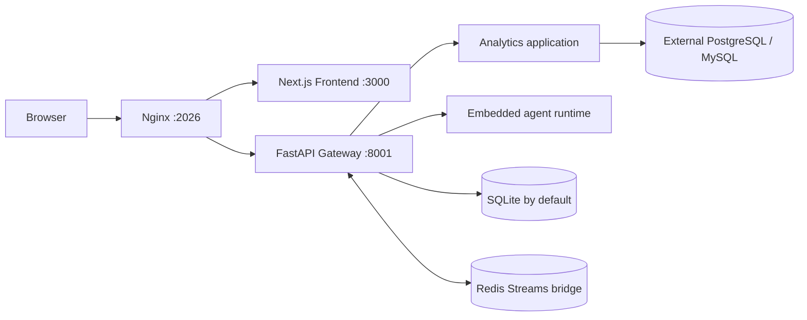

# InsightFlow 当前架构

核对日期：2026-10-09。本说明描述当前源码与默认服务拓扑，不把目标架构或局部测试等同于完整发布验收。最新 PostgreSQL 报告链及 API/查询安全、风险预算和 PostgreSQL adapter timeout 门禁已通过；两步预填浏览器验收与 Scheduler/重启恢复仍待完成。AS-01～AS-15 整体验收仍在进行，详见[当前功能与验收边界](../current-capabilities.md)。

## 运行拓扑

默认 Docker Compose 固定包含 Nginx、Frontend、Gateway 和 Redis。只有 Nginx 的 2026 端口发布到宿主机，默认绑定 loopback；Frontend、Gateway、Redis 端口只在 Compose 网络内通信。`make dev` 启动 Gateway、Frontend、Nginx 三个本地服务。

Gateway 是 FastAPI HTTP/API 边界，也承载 Agent run、线程、认证、Scheduler、MCP task 和 Analytics 路由。Nginx 将浏览器流量统一代理到前端与 Gateway。Redis 是默认栈的内部 Streams bridge，不是可选 profile。

## 应用与运行时分层

`backend/app/` 是 InsightFlow 产品应用；`backend/packages/harness/` 提供可复用的 Agent runtime。App 可以依赖 Harness，Harness 不得依赖 App。Gateway 通过 RunManager、`run_agent()` 和 StreamBridge 驱动 Lead Agent。扩展经独立的 `deerflow-extension-api` 契约接入；扩展代码以 Gateway 权限运行，只能加载可信来源。

Analytics 代码按五层组织，依赖由外向内组合：

1. `domain/` 定义数据源、schema、访问策略、指标、查询计划、证据及报告等业务契约。
2. `application/` 编排目录读取、授权、执行和报告发布用例及 ports。
3. `infrastructure/` 实现 SQLite/其他持久化、密钥引用、SQL 策略、语义授权与业务数据库客户端。
4. `agent/` 将受控用例包装为 Agent 可调用的能力，并生成证据及发布报告。
5. `api/` 提供 HTTP schemas、routers 与调用适配；`composition.py` 负责依赖装配。

## 普通聊天与受控分析

普通聊天使用通用 Lead Agent，可按配置调用 MCP、Skills、Memory、沙箱和内置 `task` 子代理。定时任务通过 Gateway 的同一 run 生命周期执行，并在 `context.non_interactive=true` 时排除澄清工具。普通聊天的 operator MCP 不受 Analytics SQL Policy 保证。

受控分析通过服务端持久化 marker 和认证 owner 识别。分析 Lead 只准入三个固定工具：`inspect_business_catalog`、`query_business_data`、`write_analysis_report`。分析路径关闭通用子代理委派、Skills、Memory 与通用 plan mode；Lead 在同一 run 中调用有界 SQL Analyst 和 Data role，再由固定报告 Writer 与零工具 Reviewer 完成发布链。这些是受限角色调用，不是五个独立常驻分析 Agent。当前指标目录列出已登记口径，尚无独立自然语言口径解析服务；指标服务不是独立 Agent。

查询路径由数据目录、schema snapshot、policy 和指标定义约束。SQL 经过语法策略和语义授权后才进入只读执行；执行计划有时效和一次性语义，并受行数、字节数、时限及审计要求约束。evidence 标识用于连接同 run 的查询结果与报告引用；Reviewer 是与 Lead 共用模型、有界且零工具的发布前检查，不是独立 Reviewer 子 Agent，也不构成逐数字数学正确性证明。

用户认证由 Gateway 执行，首位管理员通过 `/setup` 创建。线程、run、事件、消息和产物读取按 owner 授权；前端权限只控制界面，不替代 Gateway 的访问检查。数据源凭据通过服务端 secret reference 使用，不应放进浏览器、仓库或普通数据记录。

## 持久化、调度与外部数据库

应用数据库默认是 SQLite：Gateway 工作目录下的 `.deer-flow/data/deerflow.db`，默认部署将它持久化在仓库 `backend/.deer-flow`。运维人员可显式配置外部 PostgreSQL 作为应用数据库；默认 Compose 不启动该 PostgreSQL。

PostgreSQL 和 MySQL 业务数据库是独立外部数据源，由管理员登记，并应使用只读凭据。它们不属于默认 Compose 栈。Local sandbox 在 Gateway 主机执行命令，使用 Gateway 进程权限；AIO 是外部 sandbox 服务的客户端配置，InsightFlow 不启动其服务端。

Scheduler 由 `config.yaml -> scheduler.enabled` 控制。忙时 occurrence 可持久化为 `queued`，随后经租约保护的 `launching` 进入普通 `running` 生命周期；排队项不占运行并发，等待受 `scheduler.queue_timeout_seconds` 限制。多实例拓扑依赖共享 PostgreSQL、heartbeat 和数据库事件配置；自动测试与源码检查不等于所有多实例部署都已验收。

## 当前限制与证据

当前不是五个专职角色协作系统，也没有知识库 RAG、动态 PII 脱敏或完整生产安全认证。普通聊天 MCP 不继承 Analytics 的 SQL 授权。真实模型及数据库样例、测试边界和未完成验收均记录在[当前功能与验收边界](../current-capabilities.md)和[发布验收场景](../acceptance/acceptance-scenarios.md)。安装和启动步骤以根目录[安装与运行指南](../../Install.md)为准。模块细节见[后端指南](../../backend/AGENTS.md)、[前端指南](../../frontend/AGENTS.md)和[后端配置参考](../../backend/docs/CONFIGURATION.md)。

源码仍保留真实机器标识，例如 `deerflow.*` 导入前缀、`DEER_FLOW_*` 配置键和 `.deer-flow` 路径；这些名字是运行接口的一部分，不等同于产品展示名称。
